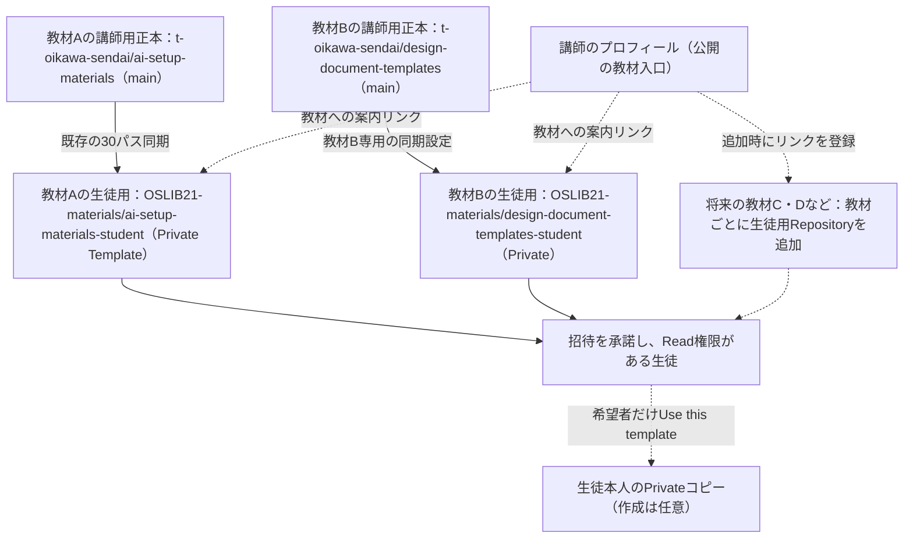
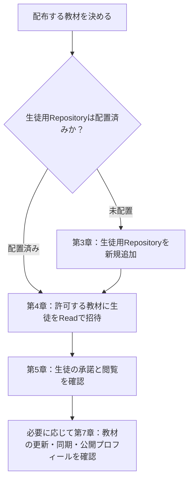
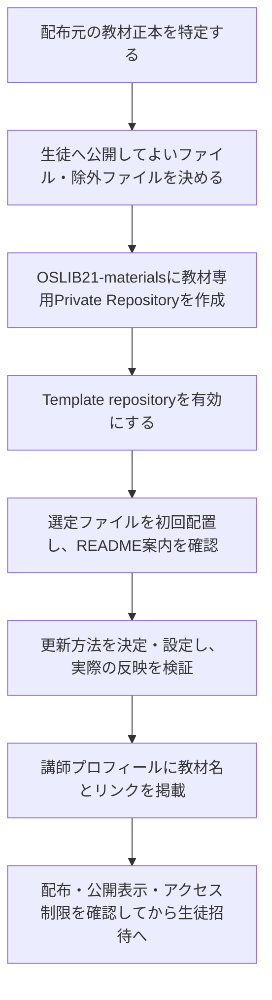
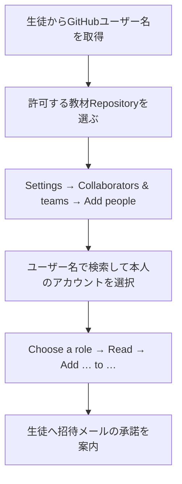
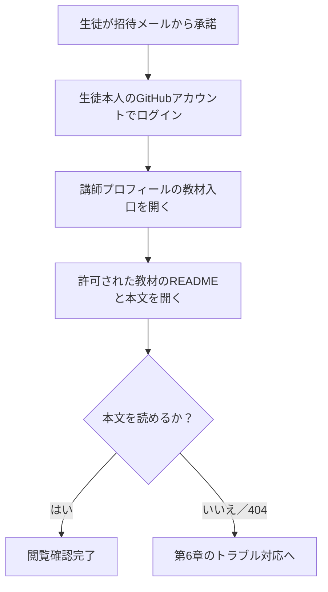
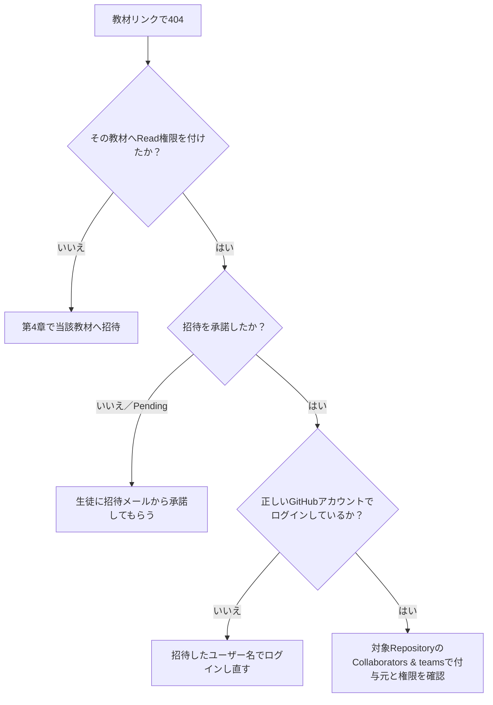
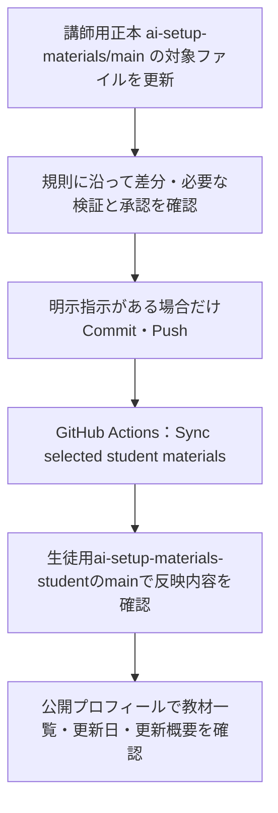
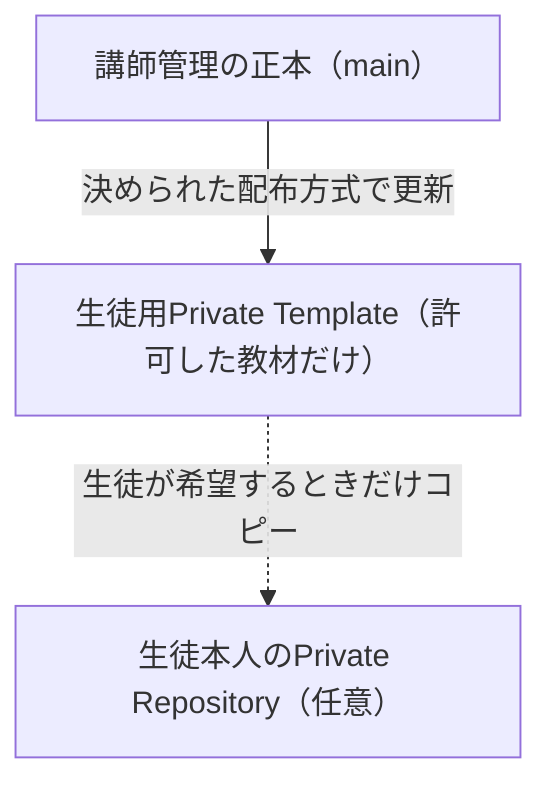

# 講師用｜GitHub Free OrganizationのPrivate Templateで教材を配布する手順書

> **改訂日：2026-11-02｜講師用正本**
> 管理先：[`docs/distribution/INSTRUCTOR_PRIVATE_ORG_TEMPLATE_GUIDE.md`](https://github.com/t-oikawa-sendai/ai-setup-materials/blob/main/docs/distribution/INSTRUCTOR_PRIVATE_ORG_TEMPLATE_GUIDE.md)（`main`）
> 本書は、操作手順と、必要時に参照する背景・検証記録を分離した版です。記載された過去の確認結果を、現在の全受講生の利用完了や、新規教材の構築完了と混同しません。

手順書2冊の編集正本は講師用Repositoryの `docs/distribution/` です。Downloads版は作業用コピーです。生徒用手順書だけを配布し、本書は配布しません。

**目的：** 講師が、許可した受講生だけに教材を閲覧させ、配布内容とプロフィールの案内を管理する。GitHub Freeの個人アカウントとOrganizationを利用する。**配布・招待の実施時期は講師が都度判断する。**

**普段の操作は第3〜7章。** 第8〜9章は必要時の管理・背景説明。過去のEvidence（確認の根拠）は付録に置く。生徒の個人Repository作成は任意であり、講師が必須操作として指示しない。

---

## 1. 教材配布の全体像

### 1.1 配布構成



**図の見方：** 講師のプロフィールは教材への公開入口であり、Private教材そのものを公開する仕組みではない。閲覧許可は**教材Repositoryごと**に設定する。AI活用入門の30パス同期を、設計文書管理入門や将来の教材にも適用済みとは扱わない。

現行の教材入口：[https://github.com/t-oikawa-sendai](https://github.com/t-oikawa-sendai)

| 教材名 | 生徒用Repository | 現在の公開範囲 |
|---|---|---|
| AI活用入門 | [OSLIB21-materials/ai-setup-materials-student](https://github.com/OSLIB21-materials/ai-setup-materials-student) | Private |
| 設計文書管理入門 | [OSLIB21-materials/design-document-templates-student](https://github.com/OSLIB21-materials/design-document-templates-student) | Private |
| 今後の教材 | `OSLIB21-materials/＜教材別の名称＞` | 作成時にPrivateを指定 |

### 1.2 講師が日常的に行うこと（縦方向）



---

## 2. 使い方：目的から探す

| 目的 | 開く章 |
|---|---|
| 新しい教材を追加する（3件目以降も含む） | **第3章** |
| 既存教材へ生徒を招待する | **第4章** |
| 承諾・閲覧の成功を確認する | **第5章** |
| Pending Invite、404、招待期限切れに対応する | **第6章** |
| 教材を更新し、生徒用と公開プロフィールを確認する | **第7章** |
| 初期設定・トークン更新など | 第8章 |
| 配布方式の理由、用語、配布対象の制約を調べる | 第9章・付録 |

**操作前提：** 講師アカウント `t-oikawa-sendai` で操作する。招待する生徒の **GitHubユーザー名**を事前に受け取る。メールアドレスでの招待機能は存在するが、この教材配布運用では**使用しない**（第9章参照）。

---

## 3. 新しい教材を生徒用Repositoryに追加する

> **適用：** 今後、新しい教材C・Dなどを追加する場合。既存のAI活用入門・設計文書管理入門のRepositoryを毎回作り直す必要はない。
> **注意：** これは新規教材追加時の共通手順です。具体的な教材名、配布範囲、更新方式、権限設計、実行結果が未確定のものは「構築済み」と扱いません。

### 3.1 全体の流れ



### 3.2 操作手順（新規教材ごとに1回）

1. **講師用正本を特定**する。対象Repository、branch（原則 `main`）、管理担当を確認する。
2. **配布対象を決める。** 生徒へ配るファイルを選び、内部文書・`AGENTS.md`・`project-notes/`・秘密情報などを配布対象にしない。追加・上書き、削除の範囲をそれぞれ明確にする。これはAI活用入門の既存30パス設定を無条件に流用することではない。
3. [**OSLIB21-materials**](https://github.com/OSLIB21-materials) で新規Repository作成画面を開き、Ownerが `OSLIB21-materials` であることを確認する。教材用の名前を指定し、**Private** で作成する。
4. 作成したRepositoryの `Settings → General` で **Template repository** を有効にし、画面上で設定を確認する。
5. 承認された配布方法で、**選定ファイルだけ**を `main` に初回配置する。READMEには教材名、内容、対象者、入口となるファイルを掲載する。既存Repositoryや既存の未Commit変更を不用意に上書きしない。
6. **その教材の更新方法を確認・決定する。** 自動同期を使う場合は、対象Repository専用の設定・権限・動作検証が必要。手動配布の場合は、更新担当と反映確認方法を明記する。**新規教材に自動同期が最初からあるとは扱わない。**
7. [講師プロフィールのRepository](https://github.com/t-oikawa-sendai/t-oikawa-sendai) の `README.md` に、教材の表示名・URL・公開方針と必要な更新情報を追加する。プロフィールの自動日付通知とは別に、新規教材リンクの掲載が必要。
8. **完了確認：** 新しいRepositoryがPrivateであること、Template設定、実際に配布したファイル・README、プロフィールの公開表示、許可者／非許可者のアクセス制限を確認する。未確認項目を完了済みとして報告しない。

**重要：** 新規教材の作成、配布対象、更新方式、リンク名は教材ごとに決定します。本章に手順があることは、個別のRepository作成や自動化の実施承認を意味しません。既存2件の設定や内容を無断で変更しません。

---

## 4. 生徒をRead権限で招待する

> **前提：** 招待は**GitHubユーザー名でのみ**行う。生徒本人からユーザー名を受け取り、講師が招待する教材を選ぶ。パスワード・認証コードは取得しない。

### 4.1 招待の流れ



### 4.2 画面操作

1. 生徒本人から**GitHubユーザー名**を受け取り、許可する教材を決める。表示名ではなく `https://github.com/＜ユーザー名＞` の末尾に入る名前を確認する。
2. 対象となる生徒用Repositoryを開く。例：AI活用入門なら [`ai-setup-materials-student`](https://github.com/OSLIB21-materials/ai-setup-materials-student)。
3. **`Settings → Collaborators & teams → Add people`** を開く（画面操作をひとまとまりとして扱う）。
4. GitHubユーザー名で検索し、**該当するアカウント**を選択する。
5. `Choose a role` で **Read** を選び、対象ユーザー名とRepository名を確認して **`Add … to …`** を実行する。
6. 生徒へ、招待したアカウントでログインして招待メールから承諾するよう案内する。**招待の期限は作成から7日間**。これは承諾までの期限であり、承諾後の閲覧期間ではない。講師側の追加承認は不要。あわせて日常の教材入口 `https://github.com/t-oikawa-sendai` を別途伝える。

**教材が2件以上の場合：** 閲覧を許可する**各Repository**で手順2〜6を実施する。組織全体への一括公開にはしない。

GitHubの自動招待メールは承諾用です。そのリンクをプロフィールURLへ差し替える設定はありません。生徒用手順書もPrivate教材内にあるため、承諾前の案内では上記の要点を講師の連絡方法で直接伝えます。

### 4.3 招待後に確認する状態

| 表示 | 意味 | 講師の対応 |
|---|---|---|
| `Pending Invite` | 招待送信済み、承諾待ち | 生徒に招待メールを確認してもらう |
| `Read` | 対象Repositoryの閲覧権限が設定された状態 | 生徒本人の実際の閲覧を第5章で確認 |
| 該当ユーザーが見つからない | 招待先・権限が確認できていない | ユーザー名と対象教材を確認する |

---

## 5. 招待承諾後の閲覧確認

### 5.1 確認の流れ



### 5.2 確認項目

- 生徒が、招待された**同一のGitHubアカウント**でログインしている。
- 招待先の教材で、`README.md` と教材本文を実際に表示できる。
- その生徒に許可していない別のPrivate教材は閲覧できない。未許可教材の `404` は想定される動作。
- 権限は教材単位で確認する。講師本人のアカウントで見えることや、プロフィールに教材リンクが表示されることだけを閲覧確認としない。

**生徒の個人Repository作成は任意です。** 自分用コピーを作らなくても教材を閲覧できる。個人コピーは講師側で作成・変更しない。

**講師がPersonaを更新しても、生徒が個人Repositoryに作成したコピーには自動反映されません。最新のPersonaを使う場合は、教材の入口から最新の配布教材を開き、該当するPersonaを改めて取得して、自分のコピーを更新する必要があります。Persona以外の教材も同様です。**

---

## 6. 困ったとき：404・Pending Invite・期限切れ

### 6.1 404の切り分け



### 6.2 症状別の対応

| 現象 | 対応 |
|---|---|
| `Pending Invite` | 生徒の承諾待ち。期限と招待メールを確認する。まだ閲覧成功とは判定しない。 |
| 招待メールが見当たらない | 招待したユーザー名、GitHubに登録された受信先、迷惑メール等を確認する。 |
| 期限切れ | 招待は**作成日時から7日間**。期限切れを確認して再招待する。必要に応じてOrganizationの `People → Failed invitations` を確認する。 |
| 許可した教材だけが404 | 招待対象のRepository、承諾、ログインユーザー名、Read権限の有無を確認する。 |
| 未許可教材だけが404 | 正常なアクセス制限。許可が必要なら講師がその教材で招待する。 |
| `Use this template` が見えない | 正しい教材を開いているか確認し、Template repository設定を調べる。 |

**期限の例：** 2026年10月29日に招待を作成した場合、原則2026年11月5日の**同時刻**まで。相手ごとの実際の招待作成日時が不明な場合、正確な期限時刻を断定しない。

---

## 7. 教材の更新・同期・プロフィールの表示確認

### 7.1 既存のAI活用入門を更新する



1. [`t-oikawa-sendai/ai-setup-materials`](https://github.com/t-oikawa-sendai/ai-setup-materials) の `main` を正本として対象教材を更新する。対象Repositoryの `AGENTS.md`、既存変更、判断記録に従う。
2. 配布するファイルの範囲を変える場合、許可リストと必要な判断記録を先に整える。単なるファイル追加では配布対象にならない。
3. **Commit・Pushは講師の明示指示がある場合だけ実施する。** `main` へのPushにより既存の同期Actionが起動する（手動実行も可能）。
4. [Actions：Sync selected student materials](https://github.com/t-oikawa-sendai/ai-setup-materials/actions) の結果が `success` であること、配布先 `main` の**実際の教材本文**が更新されていることを確認する。各stepの結果、Private・Template設定、許可リストに対応する30パス、対象外ファイルの意図しない追加がないことも確認する。既存の対象外ファイルを保持するため、配布先全体が必ず30件とは限らない。Actions成功だけで内容一致とは判断しない。
5. **講師プロフィール**の公開ページを開き、**教材リンク、教材更新日・変更概要、最近の更新（直近5件）**が実際の配布と整合するか確認する。

**自動通知と表示確認は別：** 現行の同期workflowは、AI活用入門の配布更新日をプロフィールRepositoryへ通知する設定を持つ。しかし、通知の成功はプロフィールの公開表示の正確さを保証しない。**個別の変更内容の要約や新しい教材の一覧追加まで自動で行われると想定しない。** 既存の通知は配布先 `main` の日付だけを送り、新しい日付に対して定型文「受講生向け教材の配布内容を更新しました。」を使う。同日・古い日付では表示を変更しない。講師正本だけの更新を、新たな配布日として掲載しない。詳細は[プロフィール履歴通知の設計](PROFILE_HISTORY_AUTOMATION.md)を参照する。

### 7.2 担当区分（誰が確認するか）

| 処理 | 担当 |
|---|---|
| 教材の更新・配布指示 | 講師 |
| 設定済みの30パス同期 | GitHub Actions（実行）／講師（結果確認） |
| 設定済みの更新日通知 | GitHub Actions（送信）／講師（公開表示の確認） |
| プロフィールの教材一覧・リンク追加 | 講師、または明示的に指示した作業担当 |
| **プロフィールの更新履歴・更新概要の最終確認** | **講師** |

### 7.3 AI活用入門以外の教材を更新する

- 配布元と配布先、承認済みの更新方法を**教材ごと**に確認する。設計文書管理入門は、[講師用正本の専用workflow](https://github.com/t-oikawa-sendai/design-document-templates/blob/main/.github/workflows/sync-student-template.yml)に別の同期設定がある（2026-11-02に設定本文を確認。今回の同期実行・配布結果確認は行っていない）。
- 設計文書管理入門などには、AI活用入門の30パス同期・更新日通知が自動適用されると扱わない。
- 更新した生徒用Repositoryの実際のファイルと、プロフィールのリンク・更新概要・更新履歴を講師が確認する。
- 未確認の同期方法を補うために、他Repositoryへ無断でworkflowやTokenをコピーしない。

### 7.4 同期の再実行・失敗時

- 手動再実行：講師用 `ai-setup-materials` の **`Actions → Sync selected student materials → Run workflow`** で `main` を選ぶ。講師用Repositoryへの適切な権限が必要。変更がなければ新Commitを作らずに終了する。
- 失敗時：失敗したstepを確認し、配布対象ファイルの欠落、状態（Status）不正、配布対象外リンク、認証情報の期限、未整理の変更など原因を特定する。
- **force push、許可リストの無条件拡大、未Commit変更の破棄・上書きは禁止。**

---

## 8. 初期設定・認証情報の維持（必要時のみ）

### 8.1 アクセス権限の前提

- GitHub Organization：[`OSLIB21-materials`](https://github.com/OSLIB21-materials)（GitHub Free）。
- 組織の `Settings → Member privileges → Base permissions` は **No permission**。組織メンバー全員へPrivate教材の権限を一括付与しない。
- 生徒は、許可する**個別Repository**に **Read** 権限で招待する。組織への参加招待（`People → Invite member`）を日常の教材招待操作として使わない。
- Base permissionsは組織メンバーの基本権限であり、外部コラボレーターには適用されない。既存の組織メンバーやTeamによるアクセス権限は残り得る。権限の付与元を確認せず、組織設定を変更しない。
- 2026-10-29に上記基本権限の設定が確認された（履歴）。現時点の設定の変更が疑われる場合だけ画面で再確認する。

### 8.2 AI活用入門の同期トークン

- 配置場所：講師用 `ai-setup-materials` の **`Settings → Secrets and variables → Actions → Repository secrets`**。
- Organization用Secretや配布先のSecretではなく、講師用RepositoryのRepository Secretとして管理する。GitHub FreeではOrganization-level SecretをPrivate Repositoryから利用できない（[公式資料](https://docs.github.com/en/actions/how-tos/write-workflows/choose-what-workflows-do/use-secrets)）。
- Secret名：`STUDENT_TEMPLATE_TOKEN`。配布先へ書き込むために使用する。**発行された値は記録・公開しない。**
- 2026-10-29版の設定記録では、Fine-grained PATのResource ownerは `OSLIB21-materials`、対象は `ai-setup-materials-student` だけ、ContentsはRead and write、MetadataはRead。
- 期限前に更新し、必要な承認状態を確認する。再発行した場合は同じSecret名の値を更新し、対象の同期結果を確認する。
- このトークンの権限は、今後増える別の配布Repositoryに自動では拡大しない。

### 8.3 講師用正本のPrivate化（別操作）

- 2026-10-29時点で、講師用 [`ai-setup-materials`](https://github.com/t-oikawa-sendai/ai-setup-materials) はPublicと記録されている。Private変更は**別の意思決定・操作**である。
- 実施前に、生徒用に配布した文書・リンクへ講師用正本のURLが混入していないか、Actionsと配布内容が整合するか確認する。
- Private変更後の表示を確認する。以前Publicだった期間の閲覧・取得は遡って無効にはできない。

---

## 9. 背景説明・技術的制約（操作中には読まなくてよい）

### 9.1 「正本」「生徒用」「個人コピー」は別物



- **正本：** 講師が管理する教材の編集・履歴の基準。
- **Private：** 許可されたGitHubアカウントだけが閲覧可能な設定。
- **Read：** 教材を閲覧できるが、元の教材へ変更を書き込めない権限。
- **Template repository：** 生徒が独立したRepositoryを作る際にファイル構成を再利用できる設定。
- **外部コラボレーター：** 組織メンバーになることなく、特定Repositoryに参加するユーザー。
- **Repository（リポジトリ）：** ファイルと変更履歴を管理する保存場所。
- **GitHub Actions：** 設定済みの処理を自動実行する機能。workflowはその処理手順、stepは各処理を指す。
- **Commit／Push：** 変更を履歴として保存する操作／その履歴をGitHubへ送る操作。HEADは現在参照している最新の保存地点。
- **個人コピー：** 配布元とは独立し、**講師による後日の更新やPersona更新は自動反映されない**。アクセス解除でも自動削除されない。

### 9.2 なぜGitHubユーザー名だけで招待するか

GitHub自体は、Repositoryへの招待にメールアドレスも受け付ける。しかし、メールリンクから承諾するGitHubアカウントの特定が曖昧になり得る。**本教材の運用では、講師が招待対象のGitHubアカウントを特定できるよう、ユーザー名での招待に限定する。** メールアドレスによる招待は本マニュアルの日常手順に含めない。メール招待はGitHub登録済みアドレスに限らず、別アカウントでも承諾できるという[公式説明（Email Invitations）](https://bounty.github.com/ineligible.html)に基づく。Organizationのメンバー招待のメール条件とは区別する。

### 9.3 AI活用入門の配布範囲を増減するときの制約

- 配布先は、講師正本 [`scripts/sync_student_template.py`](https://github.com/t-oikawa-sendai/ai-setup-materials/blob/main/scripts/sync_student_template.py) の許可リストで管理する**30パス**が現在の追加・上書き対象。
- 配布元から削除されたときに配布先から自動削除できるのは、当初承認済みの**旧9パスのみ**。残る21パスが正本から消えた場合は、勝手に削除せず同期を停止する。
- `AGENTS.md`、`project-notes/`、選外の`docs/`、秘密情報、選外Personaは生徒へ配布しない。
- 配布先向けに案内・リンクを調整するのは、Root README、Education README、Reference README、`WHY_PERSONA_MATTERS.md`、`PERSONA_IDENTIFICATION_AND_SETUP.md` の配布コピーだけ。Root READMEから生徒用手順書へ案内し、Root／Reference READMEからS-SETUPの案内を除く。講師正本とその他の選定ファイル本文は改変しない。Draft／Approved／Deprecatedの表示を昇格・偽装しない。通常文書はDraftとApprovedの間だけ同期を継続し、その他の状態・不正表示では停止する。旧資料はArchive NoticeがDeprecated、内部Document InfoがDraftという条件を維持する。生徒用手順書はPersonaのStatus検査対象外だが、秘密情報・リンク・配布範囲の検査は行う。
- `PERSONA_SETUP_ADVISOR.md`（S-SETUP）は追加・更新対象から除外し、配布版のREADMEからも利用案内を除外する。正本本文は保持し、既存の生徒個人コピーや履歴には手を触れない。
- 講師用手順書は配布対象外。選定文書に内部文書のファイル名だけを記したコメントが残る場合も、内部文書の本文は配布しない。配布先の許可リスト外のファイル・他branch・過去の履歴は変更しない。
- S-SETUPの同期除外は配布済みファイルの自動削除を意味しない。2026-10-29の個別削除指示（D-083）とその実施結果は[CURRENT](../../project-notes/CURRENT.md)と付録Bを参照する。自動削除の旧9パス境界は拡張しない。
- 教材のライセンスや授業上の再配布条件は、アクセス権とは別に案内する。
- 課題がないことを確認する目的だけで全ファイルの再検証を繰り返さない。必要な差分・証拠に対象を絞る。

---

## 付録A. 現行配布ファイル（AI活用入門・30パス）

```text
README.md
LICENSE
docs/distribution/STUDENT_PRIVATE_ORG_TEMPLATE_GUIDE.md
personas/WHY_PERSONA_MATTERS.md
personas/AI_ISSUES_EVIDENCE.md
personas/SYCOPHANCY_CHALLENGER_PERSONAS.md
personas/assets/sycophancy_frontier_models_2026.png
personas/PERSONA_IDENTIFICATION_AND_SETUP.md
personas/education/README.md
personas/education/GEM_CODE_GENERATOR.md
personas/education/GEM_RESEARCHER_DEVELOPMENT.md
personas/education/GEM_RESEARCHER_FULL.md
personas/education/GEM_RESEARCHER_LEARNING_DEVELOPMENT.md
personas/education/GEM_REVIEWER.md
personas/education/GEM_SOLUTION_PARTNER.md
personas/education/SKILLS/CODE_GENERATOR.md
personas/education/SKILLS/RESEARCHER_CAREER.md
personas/education/SKILLS/RESEARCHER_DEVELOPMENT.md
personas/education/SKILLS/RESEARCHER_LEARNING.md
personas/education/SKILLS/REVIEWER.md
personas/education/SKILLS/SOLUTION_PARTNER.md
personas/education/archive/GEMINI_PERSONA_DEFINITION-4Gem.md
personas/reference/README.md
personas/reference/CHATGPT_PERSONA.md
personas/reference/CLAUDE_PERSONA.md
personas/reference/CURSOR_PERSONA.md
personas/reference/GEMINI_PERSONA.md
personas/reference/PERSONA_OPERATION_CASE_STUDY.md
personas/reference/PERSONA_PROMPT_TEMPLATE.md
personas/reference/CHAT_HANDOFF_TEMPLATE.md
```

> 現行30パスは生徒用手順書を含み、S-SETUPを含みません。付録Bの2026-10-22時点の旧30パスとは内訳が異なります。この一覧は2026-10-29改訂時の配布範囲に基づく参照値。新しい教材を追加する際に、自動で同じ30パスを配布するものではない。最新の対象範囲は講師正本の同期スクリプトで確認する。

## 付録B. 配布実測・過去の検証記録

> この付録は**当時の記録**です。2026-10-29版の第6章を再配置したものであり、現在の受講生全員の利用状況や最新HEADを表すものではありません。

次の項目を**実際に確認したときだけ**記入します。確認中・未実施はそのまま区別します。

|確認項目|記録する内容|
|---|---|
|講師用GitHub `main`|確認日時、HEAD、対象のCommit|
|Actions|実行URL、結果、失敗stepの有無|
|配布先GitHub `main`|HEAD、実行時の許可リストのパス数、欠落・余剰・内容不一致の有無|
|Visibility / Template|Private表示とTemplate repository設定の確認結果|
|S-SETUPの同期除外|追加・更新対象に含まれず、配布版READMEの利用案内・リンクがないこと。既存ファイルの残存と同期対象を区別する|
|生徒の利用|招待・承諾、許可教材の本文閲覧、未許可教材の閲覧不可を確認。個人Repositoryの作成・利用は生徒の任意であり、閲覧テストの合格条件にしない|
|講師プロフィール|公開ページの教材リンク、更新日、更新概要、最近の更新（直近5件）の表示確認|

**配布内容の実測（2026-10-22）**：S-SETUP配布コピーを改訂した講師用GitHub `main`、ローカルHEAD、`origin/main` は `defbc2a4bc675196409fe257b392227ab6f824c4` で一致しました。[Push起動のActions実行 39777787027](https://github.com/t-oikawa-sendai/ai-setup-materials/actions/runs/39777787027) は `success` で、同期jobの全stepも成功しました。配布先のPrivate Repositoryを取得して確認した `main` のHEADは `547d018dd66f815c9d3472a8bbd98cd63c7604c0` です。trackedファイルは選定30パスと完全に一致し、正本からの配布変換後の内容と、欠落・余剰・byte不一致がありませんでした。直前の配布先HEAD `c20a3ccb656ddb9157bc0b1b7126f66704f6b9e4` は履歴上の祖先として残っています。配布先checkoutはcleanでした。

**後続の変更なし同期（同日）**：`project-notes/CURRENT.md` の確認記録だけをnoreply Git identityでCommitし、講師用 `main` へforce pushを使わず通常Pushしました。講師用GitHub `main`、ローカルHEAD、`origin/main` は `edf7780908fd996b1e7441c21af9b91623cd7fbd` で一致しました。[Actions実行 39778533319](https://github.com/t-oikawa-sendai/ai-setup-materials/actions/runs/39778533319) は `success` で、同期jobの各stepも成功し、ログに `No managed changes to publish.` と表示されました。配布先のリモート `main` は `547d018dd66f815c9d3472a8bbd98cd63c7604c0` のままで、新しいCommitは作られていません。この後続実行を、上記30パスの内容照合の代わりにはしません。

30パス版のPush後、認証済みChromeの配布先画面で `Private template`、`Use this template`、当時の最新Commit `547d018dd66f815c9d3472a8bbd98cd63c7604c0` を再確認しました。講師用正本のGitHubメタデータは引き続きPublicです。生徒の実アカウントでの招待・テンプレート利用・S-SETUPの取得は未確認です。

**31パス版の実測（2026-10-22）**：講師用GitHub `main` の配布変更Commitは `7a3f93780f79f060c28d8e7599a8a4827d7db0fa` です。[Push起動のActions実行 39784304065](https://github.com/t-oikawa-sendai/ai-setup-materials/actions/runs/39784304065) は `completed/success` で、同期jobと全stepが成功しました。配布先Private Repositoryの `main` は `d884959264795d1b82f3bde74dab1e91f87959eb` です。SSHで取得したcleanな配布先のtrackedファイルは許可リスト31パスと完全に一致し、配布変換をdry-runで照合した31/31パスの内容もbyte単位で一致しました。前回の配布先HEAD `547d018dd66f815c9d3472a8bbd98cd63c7604c0` から変わったのはRoot READMEと生徒用手順書の2パスだけで、旧HEADは履歴上の祖先です。認証済みGitHub画面でも `Private template`、`Use this template`、最新Commit `d884959264795d1b82f3bde74dab1e91f87959eb`、Root READMEから生徒用手順書へのリンクを再確認しました。講師用正本は引き続きPublicです。生徒本人の招待・テンプレート利用・個人Repositoryでの取得は未確認です。

**31パス版の手動再実行（同日）**：講師用 `main` のCommit `6b25083e620bb5bbc09c67bb04b0d3f0631e9d2e` から[手動起動したActions実行 39785400184](https://github.com/t-oikawa-sendai/ai-setup-materials/actions/runs/39785400184) は `completed/success` で、同期jobの全stepが成功しました。ログで管理対象31パスが同一内容であることと、実際の出力 `No managed changes to publish.` を確認しました。配布先を新たにfetchした後も `origin/main` は `d884959264795d1b82f3bde74dab1e91f87959eb` のままで、新しいCommitは作られていません。生徒本人の招待・テンプレート利用・個人Repositoryでの取得は未確認です。

### 2026-10-29：構成・未実施事項の旧記録

> 以下3節は旧正本の原文です。「今回」「第7章」「第7.2節」「§6」「第6章」は当時の版を指します。現在の操作先は第4〜5章、配布記録は本付録です。当時の予定を現在の未実施・実施済み判定に流用しません。

| 項目 | 現在の扱い |
|---|---|
| Organization | `OSLIB21-materials`、GitHub Freeで作成済み |
| 配布先 | `ai-setup-materials-student`。2026-10-29のGitHubメタデータでPrivate・Templateを確認。改訂開始時の `main` は `61870641fa0e4c19be042db5fd9ad7b517b01da6`。過去の同期記録は第6章 |
| 同期 | 講師用 `main` へのPushと、GitHub Actionsの手動起動に対応 |
| 配布範囲 | 今回の改訂で追加・上書き対象を30パスへ変更。従来31パスからS-SETUPを除外し、生徒用手順書は含む。自動削除は当初の9パスのみ。改訂のGitHub反映は別途確認 |
| 認証情報 | 講師用RepositoryのActions用Repository Secret `STUDENT_TEMPLATE_TOKEN` に登録済み。値は手順書に書かない |
| Organizationの基本権限 | 2026-10-29に `OSLIB21-materials` の **Base permissions = No permission** への反映を画面で確認 |
| 教材別のアクセス制限テスト | 2026-10-29、テストアカウントでAI活用を閲覧でき、設計文書は404になることをUserが確認し、合格と判定 |
| 実生徒の招待とRead権限 | 2026-10-29時点で未実施。テスト合格後、第7章の手順で開始する |
| 生徒の個人Repository | 作成は生徒の任意。講師から指示する作業ではなく、講師側で作成・変更・自動更新しない |

初回の9パス配布、その後の30パスへの拡張、S-SETUPの個人URL欄への改訂、および生徒用手順書を加えた31パス版は、それぞれGitHub Actionsで成功を確認済みです。実測した実行URLとHEAD、確認できていない事項は§6に記録します。


### 2026-10-29：アクセス制限のテスト（原文）

2026-10-29、**oikawa-solacom-test**（表示名：oikawa@test）を生徒役として確認しました。

| 確認内容 | 結果・根拠 |
|---|---|
| 再試験の開始状態 | Userが既存の組織メンバー登録を削除。削除後の権限照会は両教材とも `none` |
| AI活用だけへの招待 | UserがAI活用のRepositoryにReadで招待し、テストアカウントで承諾 |
| 許可教材の閲覧 | 承諾直後の画面でAI活用のREADME本文を確認。Userからも「AI活用はOK」と報告 |
| 未許可教材の閲覧不可 | 共通入口からの確認を案内後、Userから「文書は404なのでOK」と報告 |
| 合否 | Userが「合格」と判定 |

これはテストアカウントでのアクセス制限・閲覧の合格です。実生徒への招待は未実施で、合格後に第7.2節の手順で開始します。個人Repositoryの作成やAIによるPrivate Repositoryの取得は、今回の合格範囲に含みません。

テストで行った既存メンバーの削除は、最初から試すための操作でした。実生徒を招待する通常手順には含めません。


### 2026-10-29：S-SETUP同期除外・個別削除方針（原文）

`personas/reference/PERSONA_SETUP_ADVISOR.md` は生徒向けの追加・更新対象から外します。講師正本のファイル本文は保持します。配布版のRoot README・Reference READMEから利用案内・リンクを除き、生徒用手順書のS-SETUPの章も削除します。

同期対象からの除外だけでは、既に配布済みのファイル本体は消えません。2026-10-29のUser指示により、`OSLIB21-materials/ai-setup-materials-student` の `main` にある `personas/reference/PERSONA_SETUP_ADVISOR.md` だけを個別削除する対象としました（D-083）。まず同期除外を講師正本のGitHub `main` に反映し、その後で配布先の当該ファイルを削除します。同期スクリプトによる自動削除の範囲は旧9パスのままです。講師正本・生徒個人コピー・過去のGit履歴は削除しません。実施状況は `project-notes/CURRENT.md` で管理します。


**後続の保存・削除結果：** 現行[CURRENT](../../project-notes/CURRENT.md)には、講師正本 `bc63e706bea8a270021f1c285045b6fcd03c93e8` の反映後、配布更新 `4692d66492f651ff1b76827a399e427e0c8e8d2c`、S-SETUP個別削除後の配布先 `076622516f234689f75366c17aee6be4be8a2348`、[同期40872414223](https://github.com/t-oikawa-sendai/ai-setup-materials/actions/runs/40872414223)の成功が記録されています。これは保存済み記録の参照であり、今回の再実行や全生徒の確認ではありません。

## 付録C. GitHub公式参考資料

- [Organizationの作成](https://docs.github.com/en/organizations/collaborating-with-groups-in-organizations/creating-a-new-organization-from-scratch)
- [Template repositoryの作成](https://docs.github.com/en/repositories/creating-and-managing-repositories/creating-a-template-repository)
- [TemplateからRepositoryを作る](https://docs.github.com/en/repositories/creating-and-managing-repositories/creating-a-repository-from-a-template)
- [Actionsの手動起動](https://docs.github.com/en/actions/how-tos/manage-workflow-runs/manually-run-a-workflow)
- [Actions Secretsの利用](https://docs.github.com/en/actions/how-tos/write-workflows/choose-what-workflows-do/use-secrets)
- [Repositoryの可視性変更](https://docs.github.com/en/repositories/managing-your-repositorys-settings-and-features/managing-repository-settings/setting-repository-visibility)
- [Repositoryへの招待と権限管理](https://docs.github.com/en/repositories/managing-your-repositorys-settings-and-features/managing-repository-settings/managing-teams-and-people-with-access-to-your-repository)
- [外部コラボレーターの追加](https://docs.github.com/en/organizations/managing-user-access-to-your-organizations-repositories/managing-outside-collaborators/adding-outside-collaborators-to-repositories-in-your-organization)
- [組織の基本権限](https://docs.github.com/en/organizations/managing-user-access-to-your-organizations-repositories/managing-repository-roles/setting-base-permissions-for-an-organization)
- [招待の有効期限（7日）](https://github.blog/changelog/2020-02-05-self-expiring-repository-and-organization-invitations/)
- [期限切れ招待の再試行](https://docs.github.com/en/organizations/managing-membership-in-your-organization/inviting-users-to-join-your-organization#retrying-or-canceling-expired-invitations)

- [メール招待とユーザー名指定の違い（Email Invitations）](https://bounty.github.com/ineligible.html)

## 付録D. 原稿・現在の実装への参照

- [本書のGitHub管理先（講師用マニュアル）](https://github.com/t-oikawa-sendai/ai-setup-materials/blob/main/docs/distribution/INSTRUCTOR_PRIVATE_ORG_TEMPLATE_GUIDE.md)
- [生徒用マニュアル（GitHub正本）](https://github.com/t-oikawa-sendai/ai-setup-materials/blob/main/docs/distribution/STUDENT_PRIVATE_ORG_TEMPLATE_GUIDE.md)
- [GitHub Actions：AI活用入門の配布同期workflow](https://github.com/t-oikawa-sendai/ai-setup-materials/blob/main/.github/workflows/sync-student-template.yml)
- [配布対象・除外判定スクリプト](https://github.com/t-oikawa-sendai/ai-setup-materials/blob/main/scripts/sync_student_template.py)
- [講師の公開プロフィールのREADME](https://github.com/t-oikawa-sendai/t-oikawa-sendai/blob/main/README.md)
- [プロフィール履歴通知の設計](PROFILE_HISTORY_AUTOMATION.md)
- [判断履歴（DECISIONS）](../../project-notes/DECISIONS.md)
- [現在地点・反映結果（CURRENT）](https://github.com/t-oikawa-sendai/ai-setup-materials/blob/main/project-notes/CURRENT.md)

---

**未確定事項の扱い：** 新規教材C以降の具体的なRepository名・配布元・配布対象・更新方式・必要な認証情報とアクセス検証は、追加時に教材ごとに確定します。本書の採用だけで、新規Repository作成・権限変更・自動同期設定を実施済みとは扱いません。
