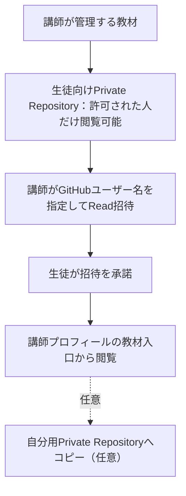
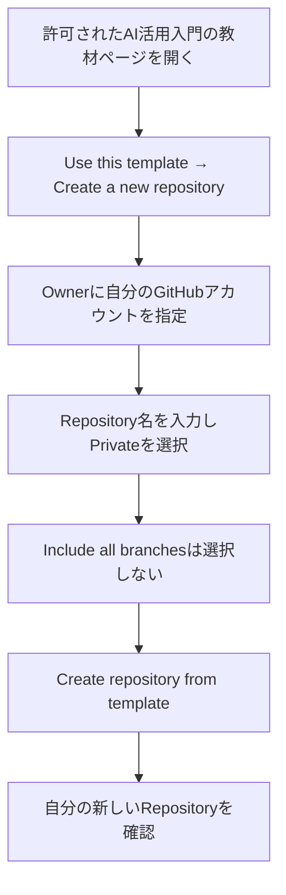
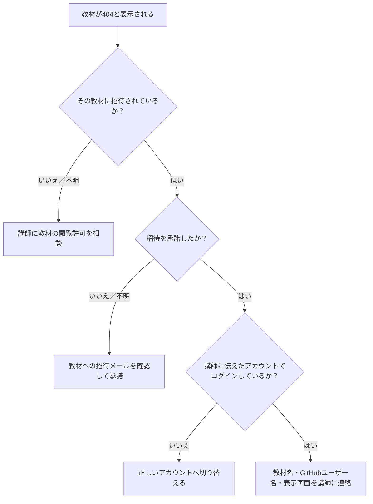
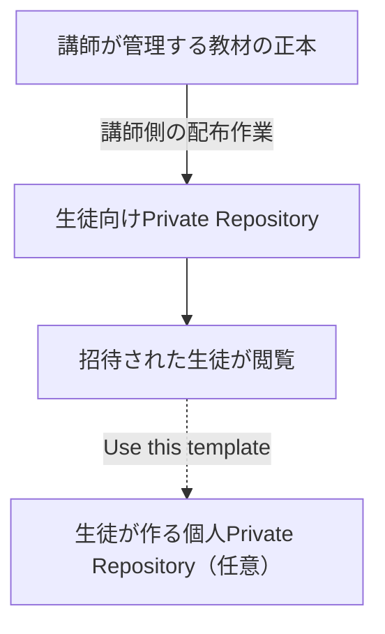

# 生徒用｜招待を承諾して限定公開のGitHub教材を読む手順書

> **改訂日：2026-11-02｜生徒用**
> 対象：IT職業訓練校の受講生
> 費用：GitHub Free
> 必要なもの：自分のGitHubアカウント、Webブラウザ、講師からの招待
> **GitコマンドやZIPダウンロードは不要です。**

**講師から招待された教材だけを閲覧できます。招待を承諾した後に講師の追加承認は不要です。教材を読むために自分のRepositoryを作る必要はありません。**

---

## 1. 教材を利用する全体像と操作

### 1.1 教材と招待の関係

**教材の入口：** [https://github.com/t-oikawa-sendai](https://github.com/t-oikawa-sendai)

**Private** は閲覧できる人を制限する設定、**Read** は講師の教材を閲覧する権限です。入口には複数の教材のリンクがありますが、招待されていないPrivate教材は開けません。

### 1.2 操作手順：招待の承諾から教材の閲覧まで

1. 自分のGitHubアカウントでログインします。
2. 講師から届いた教材への招待メールを開き、リンク先のGitHub画面で招待を承諾します。
3. 承諾後、自分で講師が指定する**[教材の入口](https://github.com/t-oikawa-sendai)**を開きます。
4. 表示された教材一覧から、講師に閲覧を許可された教材を選択します。
5. 教材のREADMEやファイル一覧から、必要な教材を開きます。

**補足：** 招待メールのリンクは、教材へのアクセスを許可してもらうためのものです。普段教材を利用するときは、講師が指定した「教材の入口」から開いてください。

**招待の有効期限は作成から7日間です。** 期限内に承諾してください。期限切れの場合は講師に再招待を依頼します。これは承諾までの期限であり、承諾後の閲覧期間ではありません。

許可された教材で `404` と表示された場合は、第5章を確認してください。**教材を読むために自分のRepositoryを作る必要はありません。**

---

## 2. GitHubユーザー名の確認

GitHubのプロフィールURLが `https://github.com/example-user` なら、GitHubユーザー名は `example-user` です。**表示名やメールアドレスではありません。**

画面右上のプロフィールアイコンなどから、ログイン中のアカウントを確認し、**GitHubユーザー名を講師に伝えてください。** アカウントを持っていない場合は、[GitHub](https://github.com/)で無料アカウントを作成します。**パスワード・認証コードは講師に伝えないでください。**

---

## 3. 自分のPrivate Repositoryに教材をコピーする

**この章は任意です。** 自分で教材を編集・保存したい場合に利用します。講師から個人Repositoryの作成を指示されるわけではなく、閲覧に必要な作業でもありません。

以下は、**AI活用入門**の `Use this template` を使う手順です。他の教材で同じ操作ができるかは、その教材の設定を確認してください。

### 3.1 コピーの流れ

### 3.2 操作手順

1. [AI活用入門の教材ページ](https://github.com/OSLIB21-materials/ai-setup-materials-student)を開きます。
2. `Use this template → Create a new repository` を選びます。
3. `Owner` は**自分の個人GitHubアカウント**を選びます。講師のOrganizationは選びません。
4. `Repository name` に任意の名前を入力します。
5. `Visibility` は必ず **Private** を選びます。
6. `Include all branches` は選ばず、基本の `main` のみを対象にします。
7. `Create repository from template` を押します。

これで、元の教材とは**独立した自分のRepository**が作成されます。講師が管理する教材には変更が加わりません。元Repositoryの過去のCommit履歴がそのまま移るわけではありません。

---

## 4. 自分用Repositoryを作った後の確認

### 4.1 確認項目（AI活用入門の場合）

- [ ] URLが `https://github.com/＜自分のユーザー名＞/＜自分のRepository名＞` になっている
- [ ] Repository名のそばに **Private** と表示されている
- [ ] `README.md`、`LICENSE`、`personas/` がある
- [ ] READMEから `docs/distribution/STUDENT_PRIVATE_ORG_TEMPLATE_GUIDE.md`（この手順書）を開ける
- [ ] 講師の教材ではなく、**自分が所有するRepository**を開いている

### 4.2 個人コピーの更新について

**講師が教材やPersonaを更新しても、自分が作成した個人Repositoryには自動反映されません。**

最新の内容が必要な場合は、[教材の入口](https://github.com/t-oikawa-sendai)から更新された生徒向け教材を開き、必要なファイルを改めて取得して、自分のコピーを更新してください。Persona以外の教材についても同じです。

自分のRepositoryを編集しても、元の教材は変わりません。また、講師が後で配布元の閲覧権限を取り消しても、既に作成した個人Repositoryは自動で削除されません。

---

## 5. 困ったときの確認

### 5.1 教材が404になる場合

### 5.2 よくある問題

| 現象 | 確認・対応 |
|---|---|
| 招待メールが見つからない | GitHubに登録したメールの受信箱と迷惑メールを確認。見つからなければ講師に連絡 |
| 招待が期限切れ | 有効期限は作成から7日間。講師へ再招待を依頼 |
| 招待リンクで別のアカウントが表示される | 講師へ伝えたアカウントに切り替え、リンクを開き直す |
| 許可されていない教材が404 | 通常のアクセス制限。必要ならその教材について講師に相談 |
| 許可された教材が404 | ログインアカウント・招待承諾・教材のURLを確認。解決しなければ講師に連絡 |
| `Use this template` がない | 正しい教材を開いているか確認し、講師に連絡 |
| 個人Repository作成時に自分がOwnerへ出ない | 正しいGitHubアカウントでログインしているか確認 |
| Repository名が使用できない | 同名のRepositoryがないか確認し、別名を選ぶ |
| 誤ってPublicで個人Repositoryを作った | **ほかの作業を止め、すぐに講師へ連絡**。後からPrivateにしても、公開中に取得された内容は取り消せません |

連絡するときは、**GitHubユーザー名、対象の教材名、起きている現象**を伝えると確認しやすくなります。パスワードや認証コードは送らないでください。

---

## 6. 仕組みと用語（必要なときに読む）

### 6.1 教材と個人コピーの関係

- **Repository（リポジトリ）**：ファイルと変更履歴を保存するGitHub上の場所です。
- **Organization（組織）**：講師が教材の公開範囲やアクセス権限を管理するGitHubの組織です。
- **Private**：許可された人だけが閲覧できる設定です。
- **Read権限**：教材を閲覧できる権限で、講師の教材を変更する権限ではありません。
- **Template repository**：ファイル構成を使って、別のRepositoryを作成できる仕組みです。
- **外部コラボレーター**：Organizationのメンバーにならず、特定Repositoryへのアクセスを許可された人です。講師からの教材招待はこの方式です。
- **README**：教材トップに表示される案内文です。
- **Draft／Approved**：文書の提案中／承認済みを表す状態表示です。コピーしただけで状態は変わりません。

### 6.2 覚えておくこと

- GitHubから届く**招待メールのリンク**と、普段利用する**講師プロフィールの教材入口**は別の役割です。
- 教材ごとに閲覧権限が設定されます。許可されないPrivate教材の `404` は想定された動作です。
- 自分用のRepositoryは自分で管理します。教材のライセンス（`LICENSE`）と講師の案内を確認し、無断公開・再配布を避けてください。
- 自分用コピーには、講師による更新が自動反映されません。

---

## 付録A. GitHub公式資料

- [テンプレートからRepositoryを作成する](https://docs.github.com/ja/repositories/creating-and-managing-repositories/creating-a-repository-from-a-template)
- [外部コラボレーターをRepositoryに招待する](https://docs.github.com/ja/organizations/managing-user-access-to-your-organizations-repositories/managing-outside-collaborators/adding-outside-collaborators-to-repositories-in-your-organization)
- [Repositoryごとの権限](https://docs.github.com/ja/organizations/managing-user-access-to-your-organizations-repositories/managing-repository-roles/repository-roles-for-an-organization)
- [招待の有効期限（作成から7日間）](https://github.blog/changelog/2020-02-05-self-expiring-repository-and-organization-invitations/)

## 付録B. この手順書の管理先

- 生徒配布版の管理対象：`docs/distribution/STUDENT_PRIVATE_ORG_TEMPLATE_GUIDE.md`
- 生徒への配布先：`OSLIB21-materials/ai-setup-materials-student`（Private Repository）
- GitHub正本への反映状況は、講師が管理・確認します。
